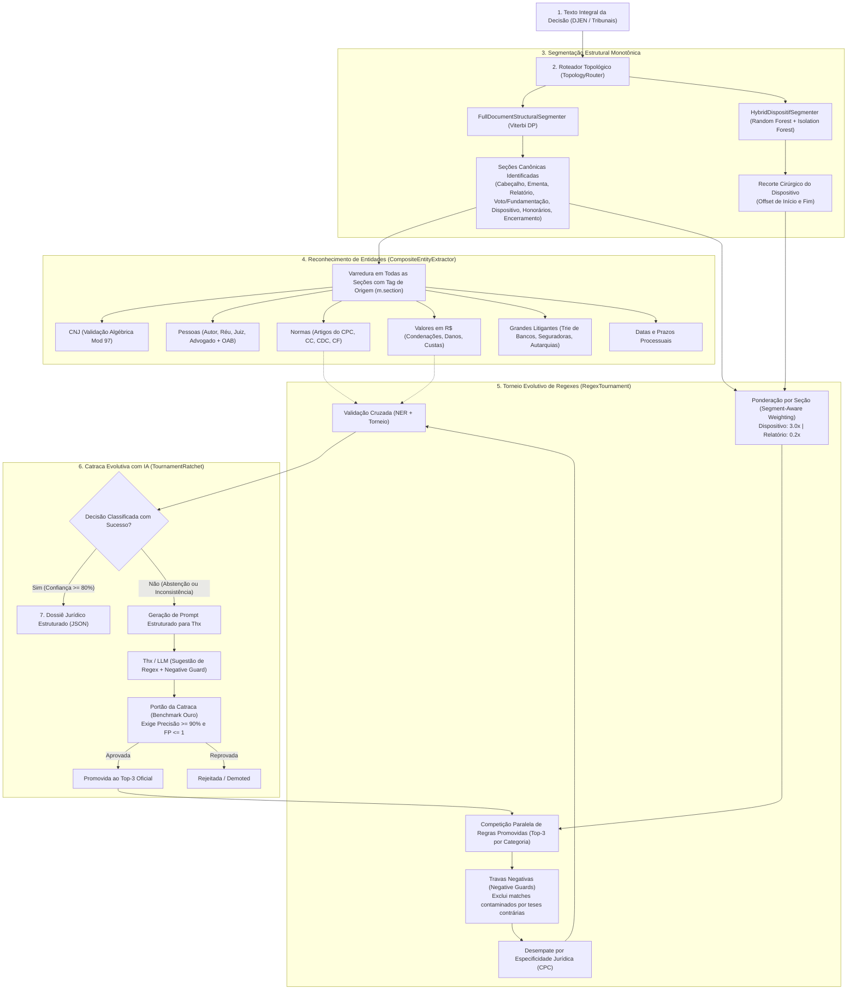

# Pipeline de Inteligência Decisória e Extração Jurídica — CausaGanha

Este documento consolida a arquitetura técnica, os contratos de dados e a dinâmica de execução do pipeline de processamento de decisões judiciais do CausaGanha (`src/causaganha/decisoes`).

---

## 1. Princípios Arquiteturais

1. **CPU-First e Baixa Latência (< 5ms):** A inferência em produção não depende de GPUs nem de chamadas síncronas a modelos neurais de bilhões de parâmetros. Todo o pipeline roda em CPU comum com alta taxa de transferência.
2. **Explicabilidade e Prova Material:** Toda classificação jurídica aponta a regra exata, o trecho original, a seção do documento e a confiança calculada historicamente. Não há "caixa preta".
3. **Separação Estrita entre Execução e Aprendizado:**
   - **Tempo de Execução (Inferência):** Roda algoritmos determinísticos e tabular-leves (Viterbi DP, Random Forest, Trie de Organizações, Validação Módulo 97 e Torneio de Regexes pré-compiladas).
   - **Tempo de Aprendizado (Offline / Flywheel):** O modelo generativo (Thx / LLM) atua exclusivamente offline para analisar falhas ou abstenções, sugerindo novas regexes com travas negativas submetidas a uma **Catraca Estrita (*Ratchet*)**.
4. **Cobertura Transversal de Entidades:** Entidades (processos CNJ, partes, advogados, normas e valores) são reconhecidas e rastreadas em 100% das seções canônicas do documento judicial.

---

## 2. Visão Geral da Arquitetura em Cascata



---

## 3. Detalhamento dos Componentes

### 3.1. Roteamento Topológico (`TopologyRouter`)
* **Arquivo:** `src/causaganha/decisoes/topology_router.py`
* **Função:** Identifica a topologia do ato judicial a partir de metadados e marcadores no cabeçalho.
* **Topologias Suportadas:**
  - `ACORDAO`: Tribunal de 2º Grau ou Cortes Superiores (fluxo canônico: Cabeçalho $\to$ Ementa $\to$ Relatório $\to$ Voto $\to$ Dispositivo $\to$ Encerramento).
  - `SENTENCA`: 1º Grau (fluxo canônico: Cabeçalho $\to$ Relatório $\to$ Fundamentação $\to$ Dispositivo $\to$ Honorários $\to$ Encerramento).
  - `EXECUCAO`: Decisões de cumprimento de sentença e execução fiscal.
  - `INTERLOCUTORIA` / `DESPACHO`: Decisões interlocutórias, liminares e atos ordinatórios.

---

### 3.2. Decomposição Estrutural e Delimitação do Dispositivo
* **Arquivos:** 
  - `src/causaganha/decisoes/structural_segmenter.py` (`FullDocumentStructuralSegmenter`)
  - `src/causaganha/decisoes/hybrid_segmenter.py` (`HybridDispositifSegmenter`)
* **Metodologia:**
  1. **Gramática Monotônica via Viterbi (Programação Dinâmica):** Divide o texto em unidades (frases/parágrafos) e calcula a emissão para cada tipo de seção, aplicando penalidades de transição para assegurar que a ordem canônica do processo civil seja respeitada (não permite que o relatório ocorra após o dispositivo).
  2. **Random Forest + Isolation Forest:** Avalia features tabulares (posição relativa, distância até o fim, densidade de âncoras e presença de advertências de citação jurisprudencial) para encontrar os offsets exatos de início e fim do dispositivo com altíssima velocidade (< 0.1ms).

---

### 3.3. Extração Seccional de Entidades (`CompositeEntityExtractor`)
* **Arquivo:** `src/causaganha/decisoes/ner/composite.py`
* **Cobertura Transversal:** Todas as seções canônicas são varridas por todos os extratores. Cada entidade extraída armazena o metadado `m.section`:
  - **`CnjExtractor` (`cnj.py`):** Captura números de processo no padrão CNJ, validando algebricamente o dígito verificador via **Módulo 97 (Resolução 65/CNJ)** e distinguindo processo principal de processos citados/paradigmas.
  - **`LegalReferenceParser` (`norma.py`):** Reconhece citações de normas com hierarquia de artigos, parágrafos e incisos (CPC, Código Civil, Código de Defesa do Consumidor, CLT e Constituição Federal).
  - **`MonetaryValueExtractor` (`money.py`):** Extrai valores em moeda corrente (R$), categorizando semanticamente entre condenação principal, dano moral, dano material, honorários advocatícios e custas.
  - **`TemporalDateExtractor` (`date.py`):** Extrai datas de fatos, julgamento, publicação e prazos de manifestação.
  - **`OrganizationTrieExtractor` (`org.py`):** Reconhece grandes litigantes (bancos, seguradoras, concessionárias de telefonia e órgãos da administração pública) através de Aho-Corasick / Trie de alta performance.
  - **`PersonAdvogadoExtractor` (`person_advogado.py`):** Extrai nomes de magistrados, partes litigantes (autor/réu) e advogados com seus respectivos números de inscrição na OAB.

---

### 3.4. Torneio Evolutivo de Regexes (`RegexTournament`)
* **Arquivo:** `src/causaganha/decisoes/regex_tournament.py`
* **Dinâmica de Seleção Natural:**
  Em vez de listas sequenciais do tipo *first-match* (que sofrem com falso positivo quando teses contrárias são citadas no relatório), o torneio avalia todas as regras promovidas em paralelo:
  - **Fórmula de Pontuação Competitiva:**
    $$\text{Score} = (\text{TP} - \lambda \cdot \text{FP}) \times \text{Precisão} \times 10.0$$
    Onde $\lambda = 2.0$ a $3.0$ impõe penalidade severa a falsos positivos. Regras com precisão $< 60\%$ ou saldo negativo são automaticamente rebaixadas (`DEMOTED`).
  - **Travas Negativas (*Negative Guards*):**
    Cada `CompetitiveRegex` possui um `negative_pattern`. Se a regra de `PROCEDENTE` der match, mas o contexto contiver termos como *"parcialmente"*, *"em parte"* ou *"não acolho"*, o match é imediatamente invalidado.
  - **Ponderação por Seção (*Segment-Aware Weighting*):**
    Multiplicadores canônicos diferenciam a força da evidência de acordo com a seção em que o match ocorreu:
    - `DISPOSITIVO`: **3.0x** (força soberana de mérito)
    - `EMENTA`: **1.5x**
    - `VOTO`: **1.2x**
    - `FUNDAMENTACAO`: **0.6x**
    - `RELATORIO`: **0.2x** (evita sequestro por citações contrárias da petição ou contestação)
  - **Desempate por Especificidade Jurídica (CPC):**
    Havendo empate ou margem estreita ($\le 15\%$), prevalece a classe de maior especificidade processual:
    $$\text{Acordo} > \text{Parcialmente Procedente} > \text{Extinto sem Mérito} > \text{Procedente / Improcedente}$$

---

### 3.5. Catraca de Aprendizado Contínuo com IA (`TournamentRatchet`)
* **Arquivo:** `src/causaganha/decisoes/tournament_ratchet.py`
* **Integração com Thx / LLM:**
  Quando uma decisão resulta em abstenção ou anomalia, o `TournamentRatchet` sintetiza um prompt padronizado contendo o dispositivo e o resultado esperado, solicitando ao modelo uma expressão regular com trava negativa em formato JSON.
* **Critério Estrito da Catraca (Promoção Gated):**
  A regex proposta pelo LLM **não entra em produção diretamente**. Ela é submetida ao benchmark ouro com decisões reais:
  - **Precisão Mínima:** $\ge 90\%$
  - **Tolerância Máxima de Falsos Positivos:** $\le 1$ FP
  - Apenas as regras que passam no portão são promovidas para o Top-3 ativo da categoria. Regras anteriores que acumulam erros são rebaixadas automaticamente.

---

### 3.6. Esteira em 3 Estágios de Open NER (`OpenNerTournamentManager`)
* **Arquivo:** `src/causaganha/decisoes/open_ner_tournament.py`
* **Dinâmica dos Três Estágios:**
  1. **Thx 1 (Explorador Aberto):** Recebe o trecho judicial bruto sem taxonomia pré-fixada e descobre livremente entidades emergentes (ex.: prazos improrrogáveis, tetos de multa diária, obrigações de fazer no Serasa, índices de correção monetária).
  2. **Thx 2 (Engenheiro de Regex):** Transforma a descoberta em uma expressão regular com grupos de captura estruturados e travas negativas de exclusão.
  3. **Thx 3 / Juiz (Adjudicação & Julgamento dos Melhores):** O Juiz testa a regex candidata contra o acervo real e avalia se o valor extraído é limpo ou ruidoso. **Apenas as regexes com precisão $\ge 90\%$ e zero/mínimo falso positivo são promovidas para o catálogo de produção**, descartando sumariamente candidatos ruins.

---

## 4. Contrato do Dossiê Estruturado de Saída

O resultado consolidado do pipeline é emitido como um documento JSON fortemente tipado:

```json
{
  "desfecho": "PROCEDENTE",
  "confianca": 0.875,
  "regra_vencedora": {
    "pattern_id": "proc_julgo_procedente",
    "secao_vencedora": "DISPOSITIVO",
    "pontuacao_efetiva": 627.54
  },
  "processo": {
    "cnj_formatado": "7019913-62.2025.8.22.0007",
    "is_valid_mod97": true,
    "tribunal": "TJRO",
    "ano": 2025
  },
  "partes": {
    "polo_ativo": ["Empresa Alfa Ltda"],
    "polo_passivo": ["Banco Beta S/A"],
    "advogados": [
      { "nome": "Dr. Carlos Silva", "oab": "12345/RO" }
    ],
    "magistrado": "Dra. Maria Santos"
  },
  "condenacao": {
    "valores_monetarios": [
      {
        "literal": "R$ 15.000,00",
        "tipo": "VALOR_CONDENACAO_PRINCIPAL",
        "secao": "DISPOSITIVO"
      }
    ],
    "honorarios": "art. 85, § 2º, CPC"
  },
  "fundamentacao_legal": [
    "art. 186, Código Civil",
    "art. 487, inciso I, CPC"
  ],
  "secoes_delimitadas": {
    "dispositivo": {
      "start": 1420,
      "end": 1850,
      "texto": "Ante o exposto, julgo procedente o pedido inicial para condenar..."
    }
  }
}
```

---

## 5. Governança e Resiliência

* **ADR 0011 (Bulkheads e Exceções):** Toda captura de exceção no pipeline captura tipos estreitos (`re.error`, `ValueError`, `KeyError`, `OSError`) ou cita explicitamente `docs/adr/0011` em pontos de bulkhead de processamento em lote.
* **Testes Contínuos:** Cobertura completa de testes automatizados em `tests/test_regex_tournament.py`, `tests/test_tournament_ratchet.py` e `tests/test_judicial_ner.py`.
